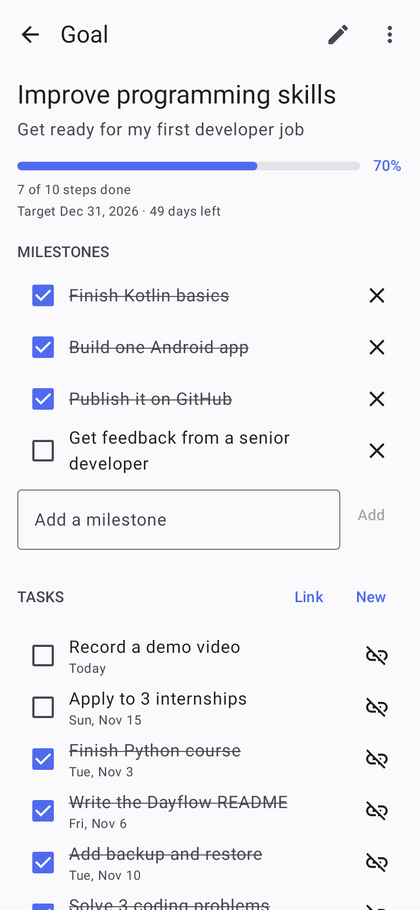
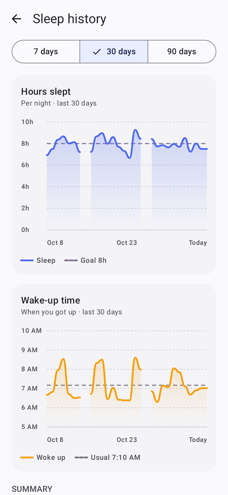
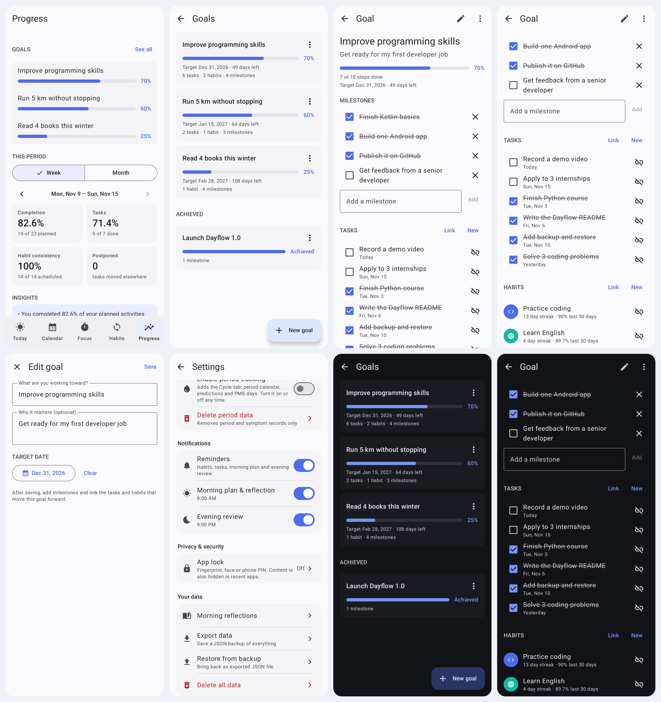
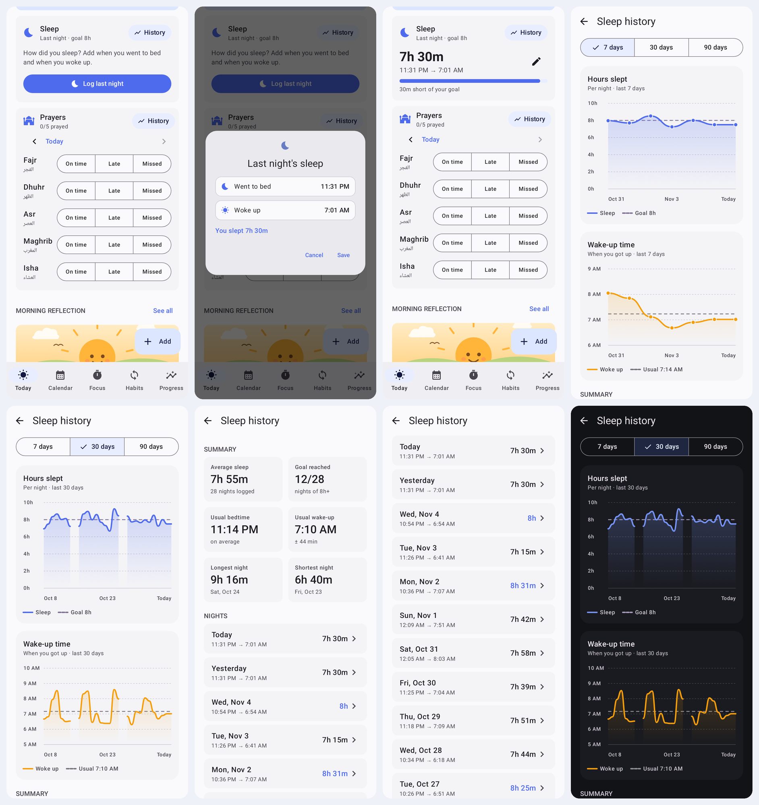
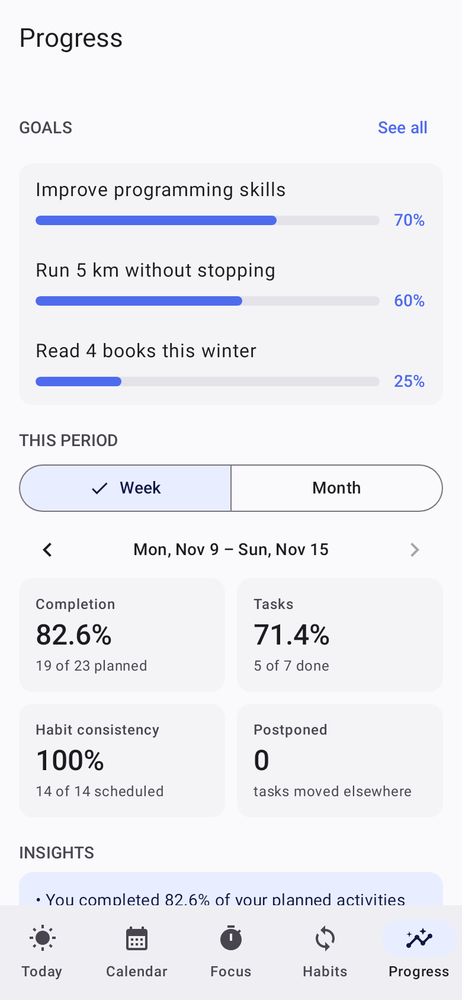
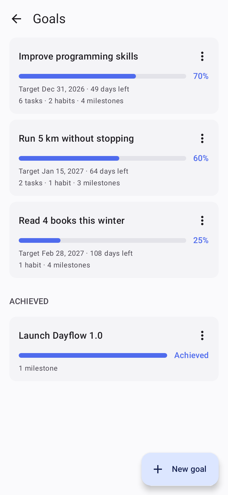
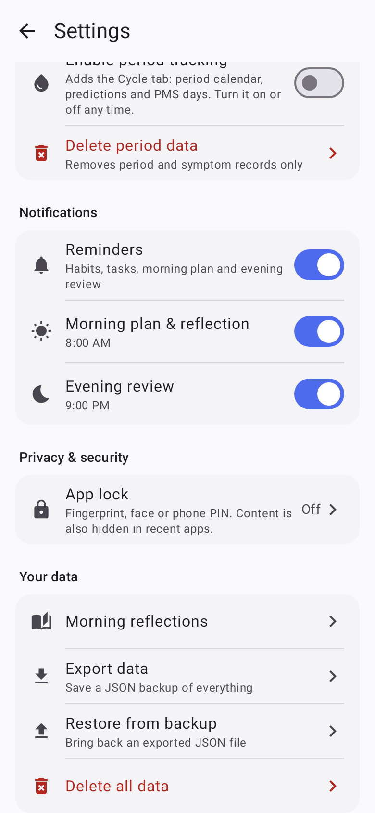
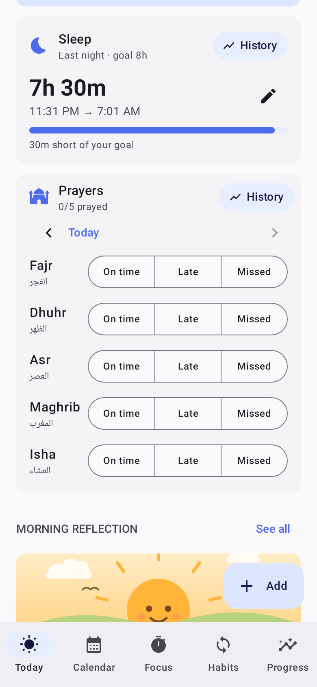
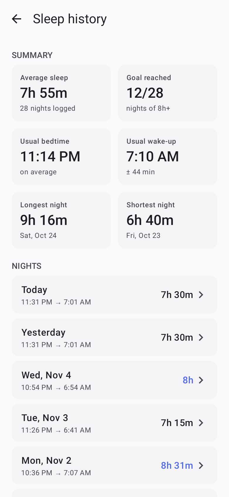

<p align="center">
  
</p>

<h1 align="center">Dayflow</h1>

<p align="center">
  <b>Plan your day. Build habits. Grow a little every day.</b><br/>
  A calm, private daily planner, habit, prayer and sleep tracker for Android.
</p>

<p align="center">
  
  
  
  
</p>

<p align="center">
  
  
  
  
  
</p>

---

##  Features

| | |
|---|---|
| ☀️ **Today** | Your tasks and habits for the day, up to three starred priorities, a live progress ring and a morning reflection with mood, energy and a photo. |
| 🕌 **Prayer tracker** | Mark Fajr, Dhuhr, Asr, Maghrib and Isha as **on time**, **late** or **missed**. Includes a daily streak, a line chart over 7 / 30 / 90 days and a breakdown for each prayer. |
| 🌙 **Sleep tracker** | Log when you went to bed and woke up. Line charts show your hours of sleep and your wake-up times, plus your average, your goal and how steady your schedule is. |
| 🔁 **Habits** | Habits for any days of the week, with goals, busy-day **minimum versions**, streaks and rest days. Editing a habit never rewrites past days. |
| 📅 **Calendar** | Week and month views. Unfinished tasks are never moved automatically: you choose where they go. |
| ⏱️ **Focus** | A focus timer with short and long breaks, linked to tasks, with a session history. |
| 🎯 **Goals** | What you are working toward over weeks or months. Each goal has milestones, linked tasks and linked habits, an optional target date and a progress bar. Open them from the Progress tab. |
| 📈 **Progress** | Completion charts, habit rates and a consistency heatmap. |
| 🩸 **Cycle** *(optional)* | Period calendar, predictions, PMS days and symptoms. On logged period days, prayers are marked as **excused** and streaks are not broken. |
| 🔒 **Privacy** | No account and no internet permission. Optional fingerprint or PIN app lock, and a JSON backup you can export and restore. |

##  Gallery

**Welcome & prayers**


**Plan your day: Today, reflection, calendar and focus**


**Habits, progress & cycle**


**Goals & backup**


**Sleep tracker**


**Dark mode**


##  First run

New users get a short welcome flow with one question per screen, then a guided tour of the app.

<p align="center">
  
  
  
  
  
</p>

- **Every question is optional.** "Skip" leaves everything off and stores nothing personal.
- **Period tracking** is offered after choosing *Female*, *Non-binary* or *Another identity*. Anyone can turn it on later in **Settings → Period tracking**.
- **Prayer tracker** is offered after answering *Yes* to "Are you Muslim?". That answer is only used to show the option and is **never saved**; only the on/off switch is stored.
- The **app tour** only shows pages for features that are turned on, and can be replayed from **Settings → App tour**.

##  Prayers

<p align="center">
  
  
  
</p>

- The **Prayers** card on Today has one row per prayer. Tap **On time**, **Late** or **Missed**, and tap again to clear it.
- **‹ ›** fills in earlier days (up to 60 days back). The 🔥 flame counts days in a row with all five prayed.
- **History** shows *prayers per day* and *on time* lines, prayed and on-time percentages, current and best streaks, and a bar for each prayer, so you can see which prayer needs the most attention.
- With period tracking on, **logged** period days are excused: the buttons are replaced by a note, the chart shades the day, and the day neither counts toward nor breaks a streak. Predicted days are not excused, since predictions can be wrong.
- Turn it on or off in **Settings → Prayers**. Prayer records are included in data export.

## 🎯 Goals

<p align="center">
  
  
  
</p>

- A goal is what you are working toward over weeks or months, such as *Improve programming skills*. Open the **Progress** tab and tap **Set a goal**.
- Give it a title, an optional reason and an optional **target date**. The goal shows how many days are left.
- Add **milestones**, and link the **tasks** and **habits** that move the goal forward. **New** creates a task or habit that is already linked; **Link** picks from the ones you have.
- **Progress** is the share of milestones and linked tasks that are done. Cancelled tasks are not counted. Habits are ongoing, so they show their streak beside the goal and do not count as steps.
- When every step is done, the goal offers **Mark as achieved**. Goals can also be archived or reopened.
- Deleting a goal keeps its tasks and habits. Deleting a task or habit only removes it from the goal.

## 💾 Backup & restore

<p align="center">
  
</p>

- **Settings → Export data** saves your tasks, habits, goals, sleep, prayers, reflections and focus sessions as one JSON file. Period data is only included if you tick it.
- **Settings → Restore from backup** brings that file back, on the same phone or a new one. It replaces the records on the phone with the ones in the file, after asking you to confirm.
- The whole file is checked before anything changes. A damaged file, a file that is not a Dayflow backup, or one from a newer app version is refused, and your data stays as it was.
- Backups made by older versions of the app still restore.
- Photos attached to reflections are not in the file. Android's phone-to-phone transfer carries those.

## 🌙 Sleep

<p align="center">
  
  
  
</p>

- The **Sleep** card on Today asks how you slept. Add when you **went to bed** and when you **woke up**; the duration is worked out for you, even across midnight.
- A progress bar shows how close you came to your **sleep goal** (8 hours by default; change it in **Settings → Sleep**).
- **History** shows two line charts for 7 / 30 / 90 days: **hours slept** with your goal line, and **wake-up time** with your usual time. It also shows your average sleep, nights that reached the goal, usual bedtime and wake-up, how steady your wake-up time is, and your longest and shortest nights.
- Tap any night in the list to correct or delete it. Sleep records are included in the backup file.

## 📥 Download & Install APK

You can download and install the official pre-built APK (Dayflow v1.2.0) directly from GitHub Releases:

- 🚀 [**Download Latest Release (Dayflow v1.2.0)**](https://github.com/homaira-mohammadi/DayFlow/releases/latest)
- 📦 [**View All Releases**](https://github.com/homaira-mohammadi/DayFlow/releases)

### 🏷️ How Releases Work & Automated Builds

This repository includes an automated GitHub Actions workflow to publish APKs:

1. **Automatic Release on Git Tag**:
   Push tag `v1.2.0` to trigger an automated release build:
   ```bash
   git tag v1.2.0
   git push origin v1.2.0
   ```

2. **Manual Upload**:
   Upload `Dayflow-1.2.0.apk` directly at [https://github.com/homaira-mohammadi/DayFlow/releases/new](https://github.com/homaira-mohammadi/DayFlow/releases/new).

## Build & run

1. Open this folder in **Android Studio** (Ladybug or newer).
2. Let Gradle sync, then run the `app` configuration on a phone or emulator (Android 8.0+).
3. Run the unit tests:

```bash
./gradlew test
```

Or build an installable APK:

```bash
./gradlew assembleDebug
```

The APK is written to `app/build/outputs/apk/debug/app-debug.apk`.

## Tech stack

- **Kotlin** and **Jetpack Compose** (Material 3), with edge-to-edge UI, dynamic color and a dark theme
- **Room** with versioned migrations (current schema version 8), plus **DataStore** for settings
- **AlarmManager** reminders with Done / Snooze / Tomorrow actions
- **androidx.biometric** for the optional app lock
- No third-party analytics, no network access

## Code map

- `domain/`: pure rules for scheduling, streaks, completion %, minimum versions, cycle predictions, prayer streaks and goal progress. All unit-tested.
- `data/db`: Room entities, DAOs and migrations. Habit schedules are *versioned*, so editing a habit never rewrites past days. Every migration only adds tables or columns, and `MigrationTest` upgrades a database from each older version to check that no data is lost.
- `data/repo`: repositories. `PlanRepository` exposes one `History` snapshot that every screen derives from.
- `notifications/`: reminders and boot handling.
- `ui/`: Compose screens and ViewModels (`onboarding/`, `today/`, `prayer/`, `habits/`, `calendar/`, `focus/`, `progress/`, `goals/`, `cycle/`, `settings/`).

## Updating without losing data

- Every new feature that needs storage adds a database version with a migration that **only adds tables or columns**. Existing records are never rewritten or deleted, and the app never falls back to wiping the database.
- `MigrationTest` builds a database the way each older version left it, upgrades it with the real migrations and checks the data is still there. Room saves each layout in `app/schemas`, so a new version is covered as soon as its file is committed.
- `BackupRestoreTest` exports from one database and restores into another, including damaged files.
- These run on the computer with `./gradlew test`. No phone or emulator is needed.

## Privacy & security

- **No internet permission.** Data only leaves the phone through an export you start, or a direct phone-to-phone transfer.
- **Moving to a new phone:** use Android's phone-to-phone transfer, or **Settings → Export data** on the old phone and **Settings → Restore from backup** on the new one. A restore replaces the records on the phone with the ones in the file; the file is fully checked first and the swap is a single transaction, so a damaged file changes nothing. Settings are kept, period data is only replaced if the backup includes it, and photos are not part of the backup file.
- **Backups:** personal records (database, photos, settings, timer state) are excluded from Google cloud backup and only included in device-to-device transfers (`res/xml/data_extraction_rules.xml`, `backup_rules.xml`).
- **Settings only store values that differ from the defaults**, so nothing personal is kept until you choose it.
- **App lock** (Settings → Privacy & security) covers the whole app or only Journal & Cycle, using the phone's biometrics or screen-lock PIN. It relocks 30 s after you leave the app, and while it's on, `FLAG_SECURE` hides content from recent apps and screenshots.
- **Period data** stays in the Cycle tab. It isn't used in Progress reports, is left out of exports unless "Include period data" is ticked, can be deleted separately, and cycle notifications hide their content on the lock screen.
- **Not yet done:** encrypting the database at rest (e.g. SQLCipher). The app sandbox protects it on non-rooted phones.
