<p align="center">
  
</p>

<h1 align="center">Dayflow</h1>

<p align="center">
  <b>Plan your day. Build habits. Grow a little every day.</b><br/>
  A calm, private daily planner, habit tracker and prayer tracker for Android.
</p>

<p align="center">
  
  
  
  
</p>

<p align="center">
  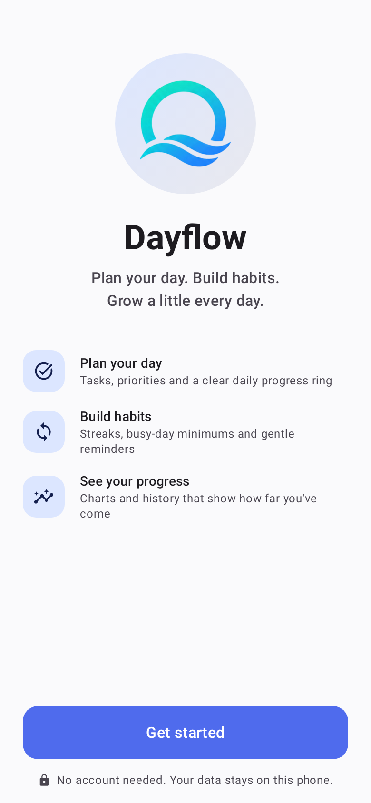
  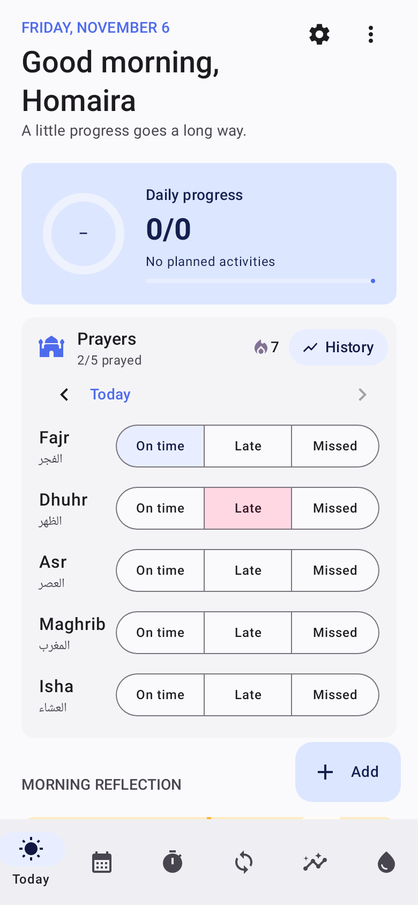
  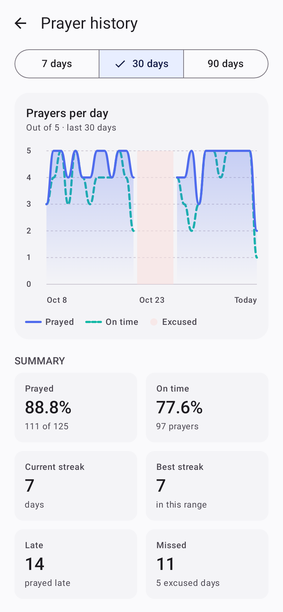
  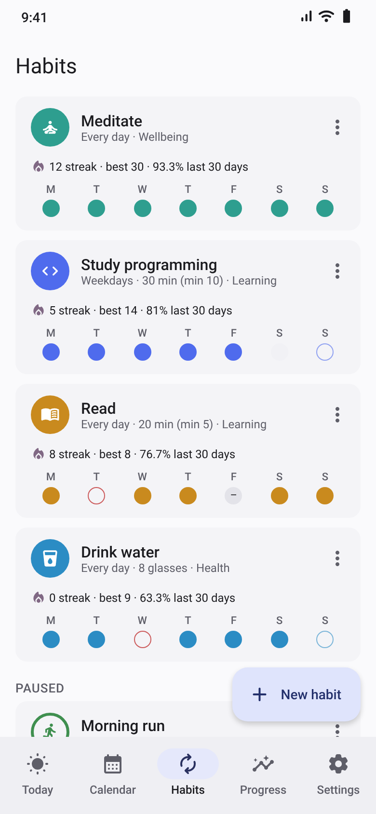
</p>

---

##  Features

| | |
|---|---|
| ☀️ **Today** | Your tasks and habits for the day, up to three starred priorities, a live progress ring and a morning reflection with mood, energy and a photo. |
| 🕌 **Prayer tracker** | Mark Fajr, Dhuhr, Asr, Maghrib and Isha as **on time**, **late** or **missed**. Includes a daily streak, a line chart over 7 / 30 / 90 days and a breakdown for each prayer. |
| 🔁 **Habits** | Habits for any days of the week, with goals, busy-day **minimum versions**, streaks and rest days. Editing a habit never rewrites past days. |
| 📅 **Calendar** | Week and month views. Unfinished tasks are never moved automatically: you choose where they go. |
| ⏱️ **Focus** | A focus timer with short and long breaks, linked to tasks, with a session history. |
| 📈 **Progress** | Completion charts, habit rates and a consistency heatmap. |
| 🩸 **Cycle** *(optional)* | Period calendar, predictions, PMS days and symptoms. On logged period days, prayers are marked as **excused** and streaks are not broken. |
| 🔒 **Privacy** | No account and no internet permission. Optional fingerprint or PIN app lock and a JSON export. |

##  Gallery

**Welcome & prayers**
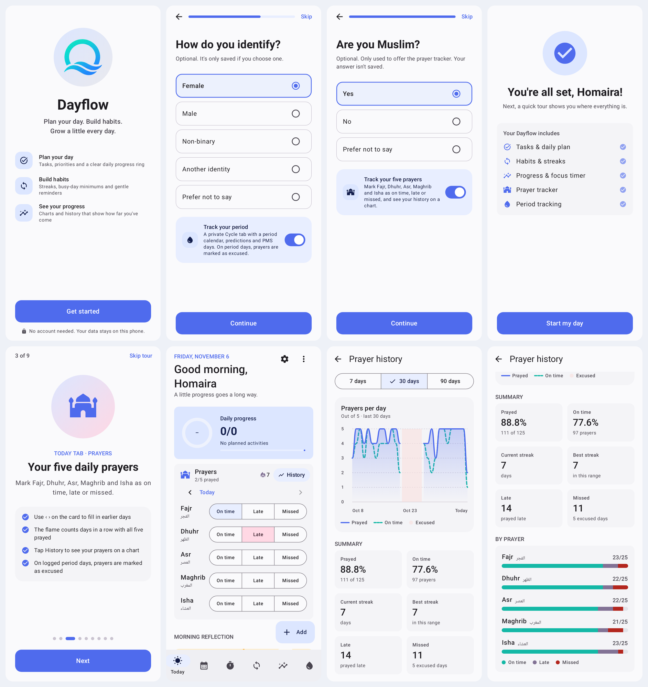

**Plan your day: Today, reflection, calendar and focus**
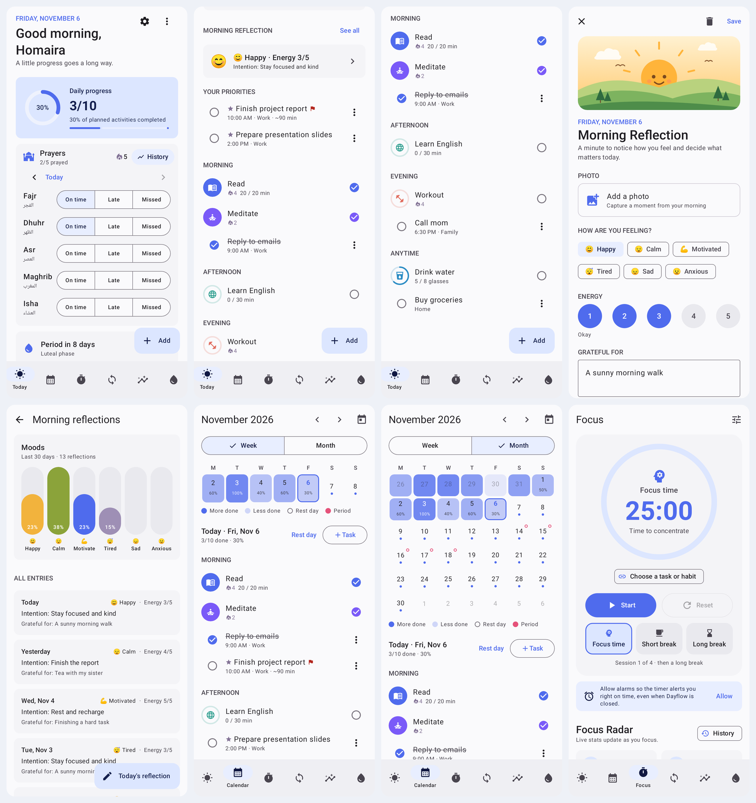

**Habits, progress & cycle**
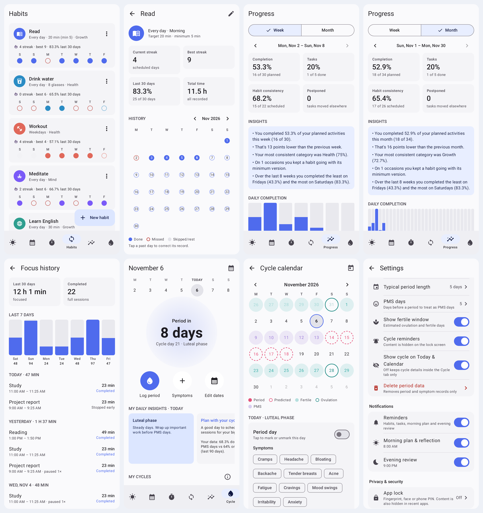

**Dark mode**
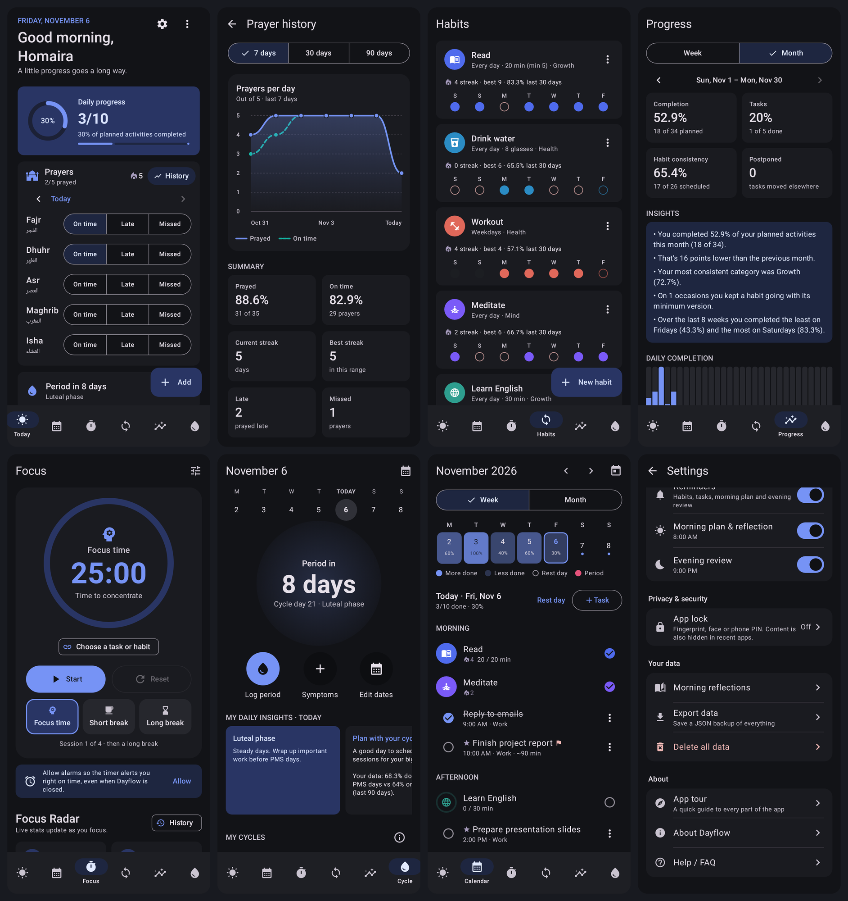

##  First run

New users get a short welcome flow with one question per screen, then a guided tour of the app.

<p align="center">
  
  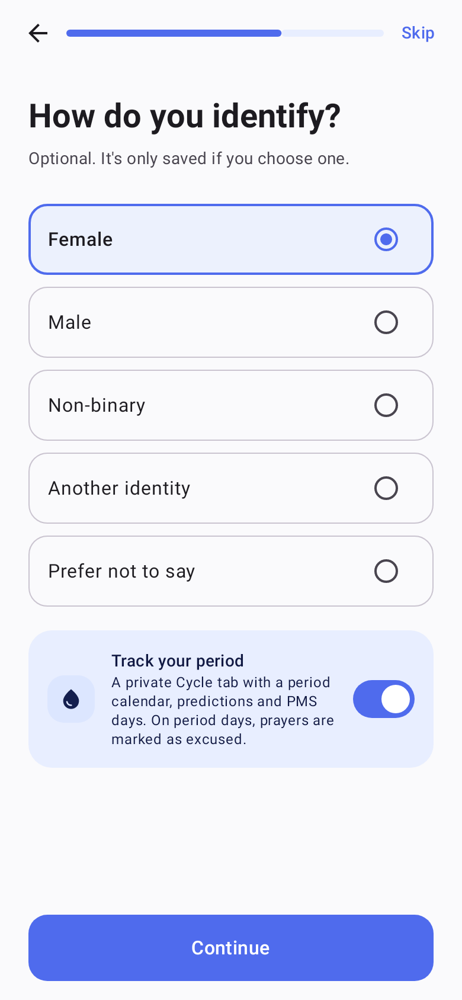
  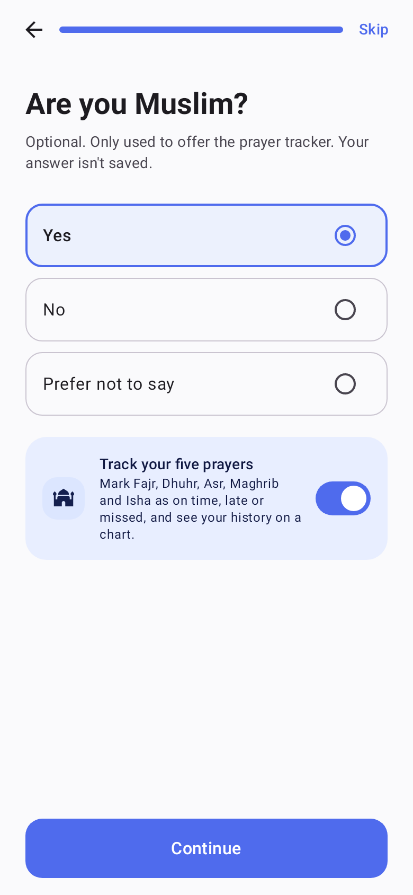
  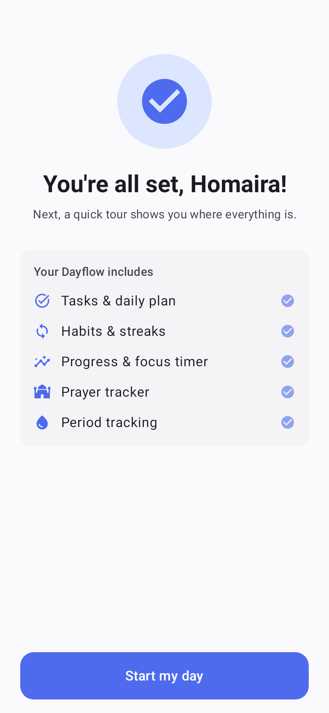
  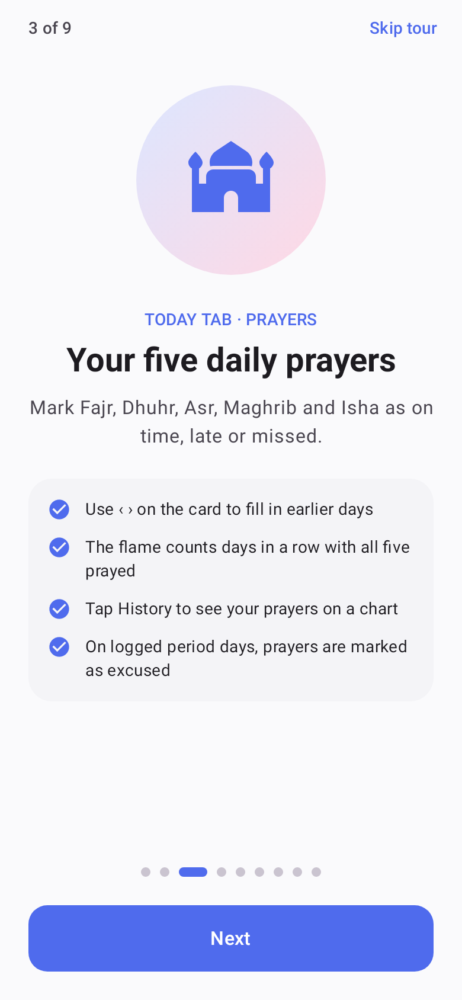
</p>

- **Every question is optional.** "Skip" leaves everything off and stores nothing personal.
- **Period tracking** is offered after choosing *Female*, *Non-binary* or *Another identity*. Anyone can turn it on later in **Settings → Period tracking**.
- **Prayer tracker** is offered after answering *Yes* to "Are you Muslim?". That answer is only used to show the option and is **never saved**; only the on/off switch is stored.
- The **app tour** only shows pages for features that are turned on, and can be replayed from **Settings → App tour**.

##  Prayers

<p align="center">
  
  
  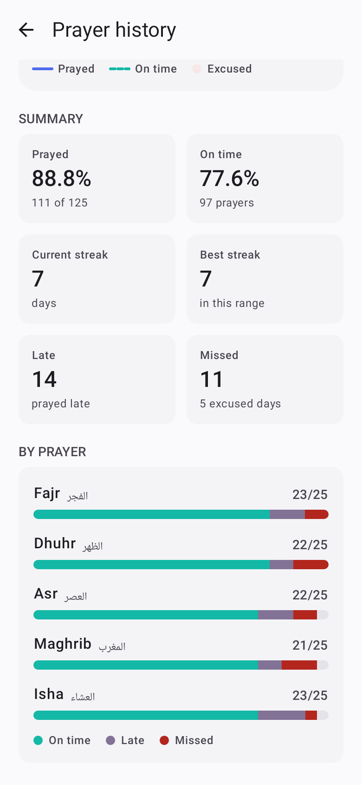
</p>

- The **Prayers** card on Today has one row per prayer. Tap **On time**, **Late** or **Missed**, and tap again to clear it.
- **‹ ›** fills in earlier days (up to 60 days back). The 🔥 flame counts days in a row with all five prayed.
- **History** shows *prayers per day* and *on time* lines, prayed and on-time percentages, current and best streaks, and a bar for each prayer, so you can see which prayer needs the most attention.
- With period tracking on, **logged** period days are excused: the buttons are replaced by a note, the chart shades the day, and the day neither counts toward nor breaks a streak. Predicted days are not excused, since predictions can be wrong.
- Turn it on or off in **Settings → Prayers**. Prayer records are included in data export.

##  Download & Install APK

You can download and install the pre-built app directly without building from source:
- Find the installable APK in the [`apk/`](apk/) folder: [`apk/Dayflow-1.0.0.apk`](apk/Dayflow-1.0.0.apk).

## Build & run

1. Open this folder in **Android Studio** (Ladybug or newer).
2. Let Gradle sync, then run the `app` configuration on a phone or emulator (Android 8.0+).
3. Run the unit tests:

```bash
./gradlew test
```

Or build an installable APK:

```bash
./gradlew assembleDebug
```

The APK is written to `app/build/outputs/apk/debug/app-debug.apk`.

## Tech stack

- **Kotlin** and **Jetpack Compose** (Material 3), with edge-to-edge UI, dynamic color and a dark theme
- **Room** with versioned migrations (current schema version 6), plus **DataStore** for settings
- **AlarmManager** reminders with Done / Snooze / Tomorrow actions
- **androidx.biometric** for the optional app lock
- No third-party analytics, no network access

## Code map

- `domain/`: pure rules for scheduling, streaks, completion %, minimum versions, cycle predictions and prayer streaks. All unit-tested.
- `data/db`: Room entities, DAOs and migrations. Habit schedules are *versioned*, so editing a habit never rewrites past days.
- `data/repo`: repositories. `PlanRepository` exposes one `History` snapshot that every screen derives from.
- `notifications/`: reminders and boot handling.
- `ui/`: Compose screens and ViewModels (`onboarding/`, `today/`, `prayer/`, `habits/`, `calendar/`, `focus/`, `progress/`, `cycle/`, `settings/`).

## Privacy & security

- **No internet permission.** Data only leaves the phone through an export you start, or a direct phone-to-phone transfer.
- **Backups:** personal records (database, photos, settings, timer state) are excluded from Google cloud backup and only included in device-to-device transfers (`res/xml/data_extraction_rules.xml`, `backup_rules.xml`).
- **Settings only store values that differ from the defaults**, so nothing personal is kept until you choose it.
- **App lock** (Settings → Privacy & security) covers the whole app or only Journal & Cycle, using the phone's biometrics or screen-lock PIN. It relocks 30 s after you leave the app, and while it's on, `FLAG_SECURE` hides content from recent apps and screenshots.
- **Period data** stays in the Cycle tab. It isn't used in Progress reports, is left out of exports unless "Include period data" is ticked, can be deleted separately, and cycle notifications hide their content on the lock screen.
- **Not yet done:** encrypting the database at rest (e.g. SQLCipher). The app sandbox protects it on non-rooted phones.
